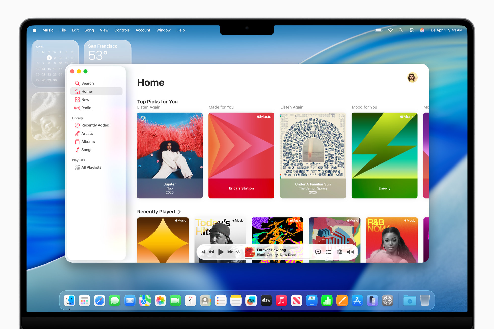
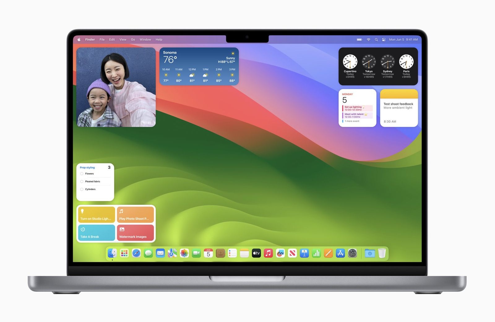

# macOS UI references: glass, system monitors, and widgets

Research captured 17 November 2026. The screenshots below are real product/platform screenshots from the linked sources; image files are stored beside this report in `references/` for local review.

## 1. Glass materials and native surfaces

*Apple Music in macOS Tahoe, official Apple Newsroom image. Shows translucent toolbar/navigation layering over the app content and the transparent menu bar. [Source: Apple Newsroom](https://www.apple.com/ca/newsroom/2025/06/macos-tahoe-26-makes-the-mac-more-capable-productive-and-intelligent-than-ever/).*

Apple's design guidance treats Liquid Glass as a distinct control/navigation layer, with standard SwiftUI/AppKit components adopting the current platform appearance. It recommends using glass for controls and navigation rather than as a blanket content background; transparency can be reduced through accessibility settings. [Apple Developer: Liquid Glass overview](https://developer.apple.com/documentation/TechnologyOverviews/adopting-liquid-glass) · [WWDC25 AppKit design session](https://developer.apple.com/videos/play/wwdc2025/310/).

**Useful visual cues:** translucent material over contextual background, clear separation between controls and content, restrained highlight/refraction, and readable contrast. iStat Menus' current product page says its v7.5 adds Liquid Glass menus on macOS 27; use it as a current menu-bar reference, while the supplied product screenshot is its documented UI and may predate that material update. [iStat Menus product page](https://bjango.com/mac/istatmenus/) · [official UI help/screenshots](https://diagnostics.bjango.com/help/istatmenus7/welcome/).

## 2. CPU, RAM, and storage monitors

*iStat Menus monitoring panels. [Source image: Bjango](https://bjango.com/images/mac/istatmenus7/menus-1.avif).*

**iStat Menus 7** is the dense, advanced reference: modular menu-bar indicators and drill-down popovers, CPU/GPU core details and history, memory pressure/swap/top processes, disk free/used space and activity, plus sensors and battery. It supports combining indicators to save menu-bar space. Current page lists macOS 13.5+ and describes a 14-day trial. [Bjango product page](https://bjango.com/mac/istatmenus/) · [official help with settings screenshots](https://diagnostics.bjango.com/help/istatmenus7/welcome/).

**Stats Panel** is a lighter, more focused comparison: its live interface demo shows processor, memory, disk, network, battery, and thermal data in one menu-bar panel; temperature, fan, and GPU readings require an optional plug-in. The website labels its demo as illustrative and says actual UI/functionality may differ. [Stats Panel interactive demo](https://statspanel.app/) · [App Store listing](https://apps.apple.com/us/app/stats-panel-system-monitor/id1528819846?platform=mac).

**Design takeaway for a new monitor:** put the primary numbers and short history charts first; reserve detailed breakdowns and process lists for a popover/detail view. Include memory pressure alongside RAM use and available storage alongside disk percentage. Make the menu-bar footprint configurable. Apple's Activity Monitor is a useful baseline for detailed process tables, while iStat is stronger for glanceable, compact custom indicators.

## 3. Widget-style apps and desktop widgets

*Apple's macOS Sonoma desktop widget showcase. [Source: MacRumors](https://www.macrumors.com/2023/06/05/apple-announces-macos-sonoma-with-desktop-widgets-and-more/).*

macOS desktop widgets are glanceable, draggable items that fade into the background when windows are in use; some support direct actions, and iPhone widgets can appear through Continuity. [Apple's Mac widget guide](https://apps.apple.com/us/mac/story/id1699687142).

**WidgetWall** is a dedicated third-party desktop widget canvas with editable widget color, size, and placement, and many content types (for example calendars, photos/video, sticky notes, music, and wallpapers). Its App Store release notes now list several widget background materials—Clear, Light, Medium, Solid—and a macOS Tahoe corner style. [WidgetWall App Store listing](https://apps.apple.com/us/app/widgetwall/id1618466427) · [MacRumors hands-on overview](https://www.macrumors.com/2023/04/25/mac-desktop-widgets-video/).

**Design takeaway for a widget-like system monitor:** offer a small compact tile (one or two metrics), a larger history/breakdown tile, and flexible placement; keep the background treatment and accent color adjustable. For a Sonoma-style widget, minimize chrome so the content fits desktop cards; for a WidgetWall-style app, a dedicated management surface can handle discovery and customization.

## Source notes

- Product capabilities and current-version statements were checked against vendor pages and App Store listings on the date above.
- Screenshot data values are examples from the captured UI, not live readings from the researcher’s Mac.
- Local screenshots: `references/macos-tahoe-music.jpg` (Apple), `references/istat-menus.avif` (Bjango), and `references/macos-widgets.jpg` (MacRumors).
